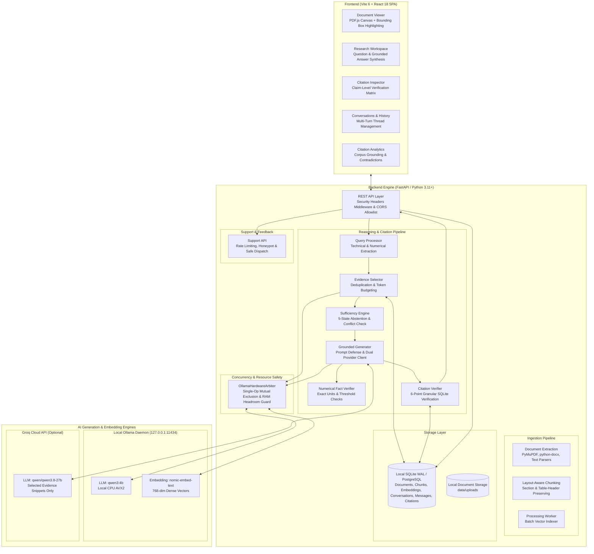

# System Architecture — DocuMind

**Project**: DocuMind — AI-Powered Document Intelligence & Research Platform  
**Version**: 0.2.1  
**Security & Network Boundary**: Local-First / Air-Gapped Capable with Optional Cloud Synthesis (Ollama bound strictly to `127.0.0.1:11434`, zero third-party telemetry, 100% cookie-free client).

---

## 1. Architectural Philosophy

DocuMind is an enterprise-grade document intelligence system designed to run on client workstations or edge servers without transmitting sensitive corporate documents to external cloud services.

### Core Architectural Pillars
1. **Local-First & Offline**: All language models, embeddings, databases, and UI components can execute strictly within the local host boundary.
2. **Strict Grounding & Verifiability**: Answers are never ungrounded. Every assertion must point to an exact document, page number, and bounding box.
3. **Decoupled Modular Architecture**: Ingestion, extraction, chunking, embedding, retrieval, query processing, evidence selection, generation, and citation verification are separated into independent, interchangeable interfaces.
4. **Hardware-Aware Design**: Tuned specifically to operate within a 16 GB RAM envelope on modern multicore CPUs with integrated graphics via a centralized hardware arbiter.
5. **Dual AI Provider Routing**: Supports 100% offline local inference via Ollama (`qwen3:4b`), alongside optional high-throughput cloud inference via Groq (`qwen/qwen3.8-27b`) while keeping embeddings and original document files strictly local.

---

## 2. System Architecture & Component Diagram

---

## 3. Modular Component Breakdown

### 3.1 Document Extraction (`backend/extraction/`)
* **Parsers**: PDF (`PyMuPDF`), Word DOCX (`python-docx`), Plain Text & Markdown (`TextMarkdownParser`).
* **Key Responsibilities**:
  * Extracts text blocks while maintaining spatial coordinates $(x0, y0, x1, y1)$.
  * Reconstructs logical reading order across multi-column layouts using spatial block sorting.
  * Preserves structural headings (H1, H2, H3) and attaches explicit `section_id` and `table_id` directly to `ExtractedBlock` models.

### 3.2 Chunking Engine (`backend/chunking/`)
* **Implementation**: `LayoutAwareChunker` (`backend/chunking/layout_chunker.py`).
* **Key Responsibilities**:
  * Enforces hard chunk boundaries on section headings.
  * Preserves tabular integrity: splits large tables along row boundaries and **replicates markdown table headers** across all successive fragments.
  * Propagates `section_id`, `table_id`, `page_numbers`, and bounding boxes to each chunk.

### 3.3 Ollama Hardware Arbiter (`backend/ollama_runtime/`)
* **Implementation**: `OllamaHardwareArbiter` and `OllamaClient` (`backend/ollama_runtime/arbiter.py`, `client.py`).
* **Key Responsibilities**:
  * Dual-lock coordination (`asyncio.Lock` and `threading.Lock`) enforcing single-operation mutual exclusion across all Ollama requests.
  * Memory headroom guard: checks `psutil.virtual_memory().percent` ($<92.0\%$) before granting inference access, raising `MemoryThresholdError` under pressure.
  * Strictly prevents concurrent execution of `qwen3:4b` and `nomic-embed-text`, eliminating model swapping thrashing.

### 3.4 Hybrid Retrieval Engine (`backend/retrieval/`)
* **Implementation**: `LocalHybridRetriever` (`backend/retrieval/hybrid_retriever.py`).
* **Key Responsibilities**:
  * Combines Okapi BM25 lexical token matching with 768-dimensional `nomic-embed-text` cosine similarity.
  * Merges rankings using Reciprocal Rank Fusion (RRF with $k=60$).
  * Enforces SQL-level document boundary isolation (`document_id` filter).

### 3.5 Evidence Selection & Sufficiency Assessment (`backend/evidence/`)
* **Implementation**: `EvidenceSelector` and `EvidenceSufficiencyEngine` (`backend/evidence/selector.py`, `sufficiency.py`).
* **Key Responsibilities**:
  * Enforces a configurable token budget (~1400 tokens) over retrieved hybrid candidates.
  * Categorizes grounding into 5 discrete states: `directly_supported`, `partially_supported`, `insufficient_evidence`, `conflicting_evidence`, `no_relevant_evidence`.
  * Fast-path abstention: triggers immediate refusal when questions ask for future dates absent from context or undisclosed credentials.

### 3.6 Grounded Answer Generation (`backend/generation/`)
* **Implementation**: `GroundedAnswerGenerator` (`backend/generation/grounded_generator.py`).
* **Key Responsibilities**:
  * Prompt injection defense: quarantines uploaded document passages inside `<untrusted_document_context>` XML boundaries and instructs model to treat them strictly as passive data.
  * Extracts dual-stream `<thinking>` traces separately from final response text, strictly suppressing internal reasoning from user views.
  * Preserves exact numerical entities and qualifiers.

### 3.7 Citation Intelligence & Fact Verification (`backend/citations/`)
* **Implementation**: `ComprehensiveCitationVerifier`, `verify_numerical_facts`, `ContradictionDetector`.
* **Key Responsibilities**:
  * Granular 6-point verification: checks document existence, chunk existence, ownership, quote match, page match, and bounding box validity.
  * Claim-to-passage support analysis: maps individual sentences to supporting chunk IDs and validates word overlap.
  * Numerical verification: cross-checks every number in the generated response against source passages.
  * Contradiction detection: flags explicit supersession and version overrides across documents.

### 3.8 Security & Support Layer (`backend/api/`)
* **Implementation**: `SecurityHeadersMiddleware`, `support.py`.
* **Key Responsibilities**:
  * Injects `X-Content-Type-Options: nosniff`, `X-Frame-Options: DENY`, `Referrer-Policy`, and CSP directives.
  * Conditionally attaches HSTS only on genuine HTTPS connections.
  * Rate-limits support submissions (5 req / 10 min per IP) and traps automated spammers with hidden honeypot fields.
